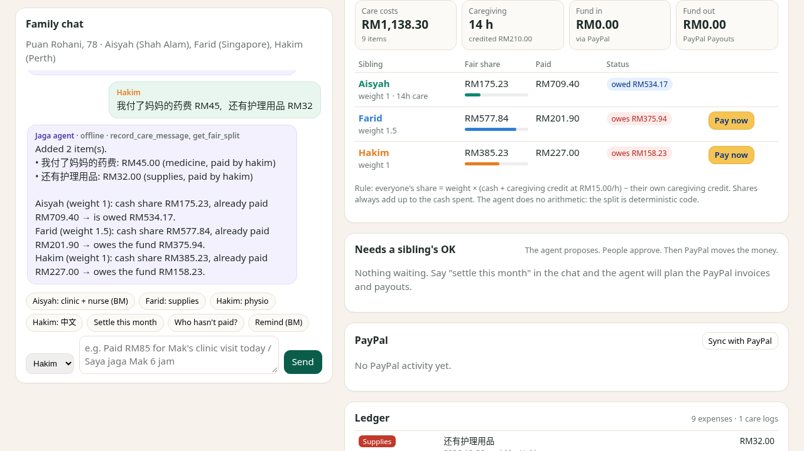

# Jaga Bersama: care for Mak, together. Fairly.

**Jaga Bersama** ("caring together" in Malay) is an AI care-cost agent for families looking after an elderly parent. Siblings post what they spent in the family chat, in English, Bahasa Melayu, Manglish or 中文. The agent:

1. keeps a shared ledger,
2. works out a fair split that **counts caregiving time**, and
3. settles the month through **PayPal**. That means Invoicing to collect shares, Checkout for anyone who wants to pay right away, and Payouts to pay back the sibling who covered the costs.

No money moves until a family member approves.

- **Live demo (no install, no keys):** https://phyllicai.github.io/jaga-bersama/. It runs entirely in your browser against a PayPal mock that returns the real sandbox response shapes.
- **Video (2:45):** see the Devpost entry.
- Built for the [PayPal AI Hackathon](https://paypalaihackathon.devpost.com/) · MIT licensed · zero npm dependencies · Node 18+



## Why

In Malaysia, families usually look after their parents themselves, and the costs are shared informally. One sibling lives nearby, goes to the clinic visits, pays the home nurse and gives up her weekends. The others live in Singapore or Perth and want to help, but nobody wants to be the one who asks for money. Spreadsheets get abandoned, resentment builds, and the sibling doing the caring quietly pays the most.

Jaga Bersama makes that conversation easy:

- the **AI** does the reading and writing (it extracts expenses from messy chat, explains the split, and drafts gentle reminders in the family's own language),
- **deterministic code** does the maths,
- **PayPal** moves the money, and
- **humans** approve.

## How it works

| Step | What happens | PayPal API |
|---|---|---|
| Record | "Bawa Mak ke klinik, consult RM85. Grab balik RM18. Saya jaga Mak 14 jam" becomes three ledger items plus 14 caregiving hours. An LLM is used if configured; otherwise a built-in offline parser handles it. LLM output is validated, so an amount that isn't in the message is dropped. | none |
| Split | Each share = weight × (cash + caregiving credit) − that sibling's own caregiving credit. Weights are agreed, e.g. the sibling in Singapore pays 1.5×, and caregiving is credited at RM15/h. Shares always add up exactly to the cash spent (largest-remainder rounding, integer sen). | none |
| Propose | "Jom settle bulan ni" creates proposals: an invoice to each sibling who owes, and a payout to each sibling who is owed. Nothing is sent yet. | none |
| Approve | Each proposal needs 1 approval, or 2 above RM500. A payout always needs at least one approver who isn't the person being paid. | none |
| Collect | Invoices have one line per category and allow partial payments. Each create is idempotent (`PayPal-Request-Id`). | Invoicing v2: `POST /v2/invoicing/invoices`, `/send`, `/remind`, `/cancel` |
| Pay now | A sibling can pay their share straight away instead. Their pending invoice proposal is then superseded, so nobody is billed twice. The PayPal fee is booked as a shared cost. | Orders v2: `POST /v2/checkout/orders`, `/capture` |
| Webhook | `INVOICING.INVOICE.PAID` / `PARTIALLY_PAID` triggers a **re-fetch of the invoice from PayPal**; the amount in the webhook body is never trusted. When live, signatures are checked with `verify-webhook-signature`. | `GET /v2/invoicing/invoices/{id}`, `POST /v1/notifications/verify-webhook-signature` |
| Reimburse | The payout runs only once the fund holds the money, and is capped at the fund balance. Any remainder stays on the ledger. | Payouts v1: `POST /v1/payments/payouts` |
| Remind | A warm reminder is drafted in EN, BM or 中文 and sent through PayPal after approval. | `POST /v2/invoicing/invoices/{id}/remind` |

Every PayPal call shows up in the in-app **API calls** log and the **audit trail**.

### AI design

- The tool names mirror the [PayPal Agent Toolkit](https://github.com/paypal/agent-toolkit) (`create_invoice`, `send_invoice`, `send_invoice_reminder`, `create_order`, `create_payout`, …).
- The chat agent is a tool-calling loop over `record_care_message`, `get_fair_split`, `propose_settlement`, `send_invoice_reminder`, `list_invoices`, `create_order`, `list_actions` and `answer_question`.
- **`approve_action` is never given to a model**, neither in the chat loop nor in MCP. Approval is a button a human presses.
- The LLM never does arithmetic. It extracts and explains, and every amount it returns is checked against the message text.
- Without an LLM key everything still works: the offline parser understands English, Malay and Manglish (`RM`, `ringgit`, `jam`), and Chinese (`我付了…RM45`, `小时`).

### MCP server

`mcp.js` is a zero-dependency stdio MCP server that exposes the same tools, so Claude Desktop, Cursor or any MCP client can record costs and propose settlements on the family ledger:

```json
{ "mcpServers": { "jaga-bersama": { "command": "node", "args": ["/path/to/jaga-bersama/mcp.js"], "env": { "JB_SERVER_URL": "http://localhost:8790" } } } }
```

If the web app is running, the tools act on its ledger, and the proposals appear in the UI for a human to approve. Otherwise the server runs in-process with the demo family.

## Run it

```bash
git clone https://github.com/phyllicai/jaga-bersama && cd jaga-bersama
npm start            # http://localhost:8790 (mock PayPal, offline parser, no keys needed)
npm test             # 33 tests, node:test, no dependencies
```

Open http://localhost:8790/?demo to start with the demo family's messages loaded, or click the chips to replay them one at a time. In mock mode, the "Simulate … pays" buttons stand in for a sibling paying on PayPal's invoice page.

### Use the real PayPal sandbox

1. Log in at https://developer.paypal.com and go to **Apps & Credentials → Sandbox → Create App** (type: Merchant). Copy the Client ID and Secret.
2. Under **Sandbox → Accounts**, note the default *personal* test account email, or create one per sibling.
3. Copy `.env.example` to `.env` and fill in `PAYPAL_CLIENT_ID` and `PAYPAL_CLIENT_SECRET`. Set `JB_EMAIL_FARID=...`, `JB_EMAIL_HAKIM=...` and `JB_EMAIL_AISYAH=...` to sandbox personal-account emails. Use `PAYPAL_CURRENCY=USD` unless your sandbox business account is Malaysian.
4. Run `npm run smoke:sandbox`. This calls OAuth, creates, sends, reads and cancels an invoice, and creates an order. Add `SMOKE_PAYOUT=1` to also test Payouts (Payouts must be enabled on the sandbox app).
5. Run `npm start`. The header now shows **PayPal: sandbox**. Invoices open PayPal's real payer page, and "Pay now" redirects to the PayPal sandbox approval page and back.
6. Optional: add a webhook in the app pointing to `https://<your-tunnel>/api/paypal/webhook` (events `INVOICING.INVOICE.*` and `PAYMENT.CAPTURE.COMPLETED`), then set `PAYPAL_WEBHOOK_ID`. Without webhooks, "Sync with PayPal" polls instead.

The code refuses to run the smoke test against live PayPal. Secrets are only read from `.env`, which is git-ignored.

### Optional LLM

Set `LLM_API_KEY` (and optionally `LLM_BASE_URL` / `LLM_MODEL`) to any OpenAI-compatible `/chat/completions` endpoint. The header then shows **AI: LLM (model)**. If the model fails, the app falls back to the offline parser and records that in the audit log.

## Project layout

```
server.js            zero-dependency HTTP server (serves public/ and the JSON API)
mcp.js               MCP stdio server (same tools, no approve)
src/api.js           API router, shared by server.js and the static demo
src/service.js       ledger, split, proposals, approvals, PayPal orchestration
src/split.js         the fair-split engine (integer sen, caregiving credit, weights)
src/parse.js         offline EN/BM/中文 parser
src/tools.js         agent tools + tool-calling loop
src/ai/              LLM client, multilingual reminder drafts
src/paypal/client.js PayPal REST client (OAuth2, Invoicing v2, Orders v2, Payouts v1, webhooks)
src/paypal/mock.js   offline PayPal with the same JSON shapes, fees, idempotency and webhooks
scripts/             sandbox smoke test, static (GitHub Pages) build
docs/                built static demo (npm run build:static)
video-build/         narration script + Playwright recorder for the demo video
```

## Testing

`npm test` runs 33 tests covering:

- the split maths (shares always add up; caregiving credit; weights),
- the multilingual parser,
- the live PayPal client against a fake `fetch` (exact paths, headers, bodies, `PayPal-Request-Id`, the `Prefer: return=representation` fallback, error parsing),
- the mock lifecycle,
- a full month from chat to everyone square,
- forged webhooks,
- guardrails (self-approval, double execution, stale plans that can't over-invoice, payouts capped at the fund balance),
- LLM validation and fallback,
- that the LLM loop can't approve,
- the API router, and
- the MCP server over stdio.

## Notes

- The family in the demo is fictional, and all emails are placeholders.
- The demo is not financial or legal advice. Families should agree on weights and the caregiving rate together. Both are editable via `/api/family`.

## License

MIT, © 2026 Ng Phyllis
